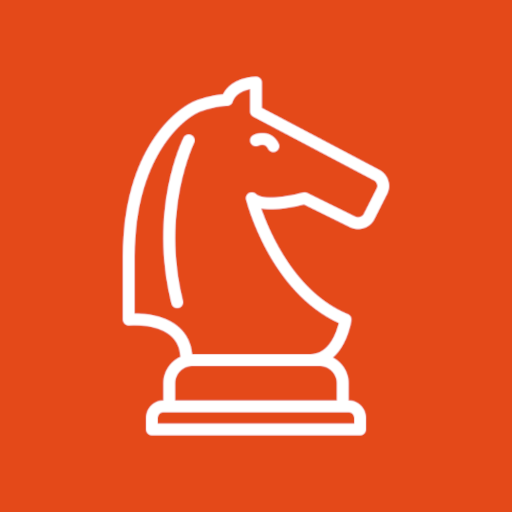

# ♟️ Chessy


&nbsp;&nbsp;




Chessy is a **simple, offline chess app** for playing against **Stockfish running in Termux**.
No accounts, no online engines, no tracking—just you versus the engine.

## ♞ What is it?

Chessy is a focused player-vs-engine chess app designed to be:

- ✅ Simple — Pick a side and start playing.
- 📶 Offline-first — Stockfish runs locally on your phone through Termux.
- 🔐 Private — No data collection, no accounts, no syncing.
- 🎯 Focused — Built solely for single-player matches against Stockfish.

With Chessy, you can:

- 🧩 Start from any position using the visual board editor or a FEN.
- 🤖 Make a move on Stockfish's behalf, or ask it for a different move.
- 📚 Practise openings and gambits with the built-in opening book.
- ↩️ Undo moves and flip the board whenever you like.
- 📜 Copy the game as PGN or the position as FEN.

## ⚙️ Requirements

Chessy has **no built-in chess engine**. It needs [Termux](https://f-droid.org/packages/com.termux/) with Stockfish installed:

```bash
pkg update -y && pkg install -y stockfish
```

The app walks you through the rest of the setup. See [USAGE.md](USAGE.md) for the full guide.

## 📥 Download

Download the latest APK from the [Releases](https://github.com/rootminusone8004/Chessy/releases/).

## 🧰 Build the app from Source

Want to build Chessy yourself? See the [BUILD_INFO.md](BUILD_INFO.md) file for full instructions.

## 📖 How to Use

New to Chessy? Check out the [USAGE.md](USAGE.md) file for a quick guide.

## 🤝 Contribute

We welcome your contributions! You can:

- ✨ Add features or fix bugs via a <a href="https://docs.github.com/en/pull-requests/collaborating-with-pull-requests/proposing-changes-to-your-work-with-pull-requests/creating-a-pull-request" target="_blank">pull request</a>.
- ♟️ Share opening and gambit lines for the opening book.
- 💡 Suggest ideas or improvements.

## 🔒 Security

If you find a security vulnerability or have a security concern, please see our [SECURITY.md](SECURITY.md) for guidance on how to report it responsibly.

## ⚖️ License

Chessy - simple offline chess app powered by Stockfish<br>
Copyright (c) 2026-present Md. Hashibur Rahman Kwoshik

This program is free software, released under the MIT License. You may use, copy, modify, merge, publish, distribute, sublicense, and/or sell copies of it, provided the copyright notice and permission notice are included.

This program is provided "as is", without warranty of any kind. See the [LICENSE](LICENSE) file for the full text.
