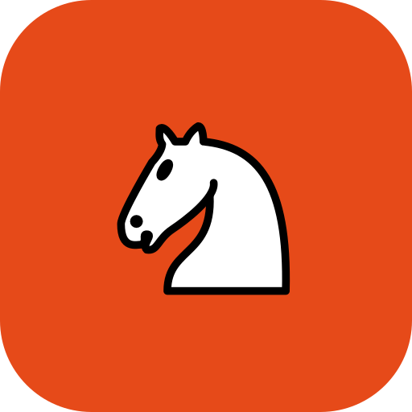

# Chessy ♟️

<p align="center">
  
</p>

<p align="center">
  <strong>A native Kotlin Android chess app powered strictly by the Stockfish engine installed via Termux.</strong>
</p>

<p align="center">
  
  
  
  
  
  
  
</p>

---

## Engine Policy & Setup

> [!IMPORTANT]
> **Strict Engine Requirement**:
> - Chessy **does not** run online chess engines.
> - Chessy **does not** have any built-in chess engine.
> - Chessy **strictly requires** the Stockfish chess engine in **Termux** to run.
> - If Termux or Stockfish is not found, the app guides installation and lets you **manually locate the engine** or connect via **phone storage (`termux-setup-storage`)**.

---

## Highlights

- ⚡ **Stockfish via Termux**: Dispatches move calculations directly to Stockfish in Termux via `com.termux.RUN_COMMAND` intent or localhost TCP socket bridge.
- 📂 **Manual Engine Locator & Phone Storage Integration**: Point to any custom Termux path (`~/stockfish`, `usr/bin/stockfish`), or leverage `termux-setup-storage` to locate Stockfish in shared phone storage (`~/storage/shared/stockfish`).
- 🛠️ **Live Diagnostics**: Built-in test console reports live exit codes, stdout, and stderr from Termux so you can easily verify engine communication.
- 🎨 **Lichess Visual Theme**: Authentic Lichess default brown board (`#F0D9B5` / `#B58863`) coupled with Colin M.L. Burnett's iconic **cburnett** piece set.
- 🟧 **Vibrant Orange Palette**: Hand-crafted UI theme in signature Vibrant Orange (`#E64A19`) and dark charcoal cards (`#2C2C2C` / `#363636`) inspired by Bazarnote.
- 🤖 **Strict Player vs. Engine**: Designed solely for single-player engine matches. Play as White or Black at customizable search depths (1–20).
- 📜 **Full Chess Notation & PGN**: Live horizontal move history, Standard Algebraic Notation (SAN), and one-touch PGN and FEN clipboard export.
- 🔄 **Undo & Flip**: Revert moves at any point or flip the board to change your view.

---

## Termux Setup

1. **Install Termux** from [F-Droid](https://f-droid.org/packages/com.termux/).
2. In Termux, run:
   ```bash
   pkg update -y && pkg install -y stockfish
   ```
3. Enable third-party external app execution in `~/.termux/termux.properties`:
   ```bash
   mkdir -p ~/.termux
   echo 'allow-external-apps = true' >> ~/.termux/termux.properties
   ```
4. **Phone Storage Access (Optional)**:
   ```bash
   termux-setup-storage && cp $(which stockfish) ~/storage/shared/
   ```
5. In Chessy, tap **"Locate Engine"** or **"Verify & Play"** to connect!

---

## Project Structure

```
chessy/
├── app/
│   ├── build.gradle
│   ├── proguard-rules.pro
│   └── src/
│       ├── main/
│       │   ├── AndroidManifest.xml
│       │   ├── java/com/mhrahmankwoshik/chessy/
│       │   │   ├── ChessyApp.kt
│       │   │   ├── data/model/
│       │   │   │   ├── EngineConfig.kt
│       │   │   │   ├── GameState.kt
│       │   │   │   ├── Move.kt
│       │   │   │   ├── Piece.kt
│       │   │   │   ├── PieceColor.kt
│       │   │   │   ├── PieceType.kt
│       │   │   │   └── Square.kt
│       │   │   ├── engine/
│       │   │   │   ├── ChessEngine.kt
│       │   │   │   ├── EngineManager.kt
│       │   │   │   ├── TermuxResultReceiver.kt
│       │   │   │   ├── TermuxSocketEngine.kt
│       │   │   │   └── TermuxStockfishEngine.kt
│       │   │   ├── game/
│       │   │   │   ├── ChessBoard.kt
│       │   │   │   ├── ChessGame.kt
│       │   │   │   ├── FenUtil.kt
│       │   │   │   └── MoveGenerator.kt
│       │   │   ├── ui/
│       │   │   │   ├── ChessBoardView.kt
│       │   │   │   ├── MainActivity.kt
│       │   │   │   ├── MoveHistoryAdapter.kt
│       │   │   │   └── dialog/
│       │   │   │       ├── GameOverDialog.kt
│       │   │   │       ├── GameSettingsBottomSheet.kt
│       │   │   │       ├── ManualEngineConfigBottomSheet.kt
│       │   │   │       ├── PawnPromotionDialog.kt
│       │   │   │       └── TermuxSetupBottomSheet.kt
│       │   │   ├── util/
│       │   │   │   ├── PreferencesManager.kt
│       │   │   │   ├── SoundPlayer.kt
│       │   │   │   └── TermuxUtils.kt
│       │   │   └── viewmodel/
│       │   │       └── ChessViewModel.kt
│       │   └── res/
│       │       ├── drawable/ (Lichess cburnett pieces, launcher icons, UI backgrounds)
│       │       ├── layout/
│       │       ├── mipmap-*/
│       │       └── values/ (colors.xml, strings.xml, themes.xml)
│       └── test/java/com/mhrahmankwoshik/chessy/
│           └── ChessGameTest.kt
├── gradle/
│   ├── libs.versions.toml
│   └── wrapper/
├── build.gradle
├── settings.gradle
├── BUILD_INFO.md
├── USAGE.md
├── CHANGELOG.md
└── SECURITY.md
```

---

## Building

```bash
# Run unit tests
./gradlew testDebugUnitTest

# Assemble Debug APK
./gradlew assembleDebug

# Assemble Release APK
./gradlew assembleRelease
```

---

## License

MIT License. See [LICENSE](LICENSE) for details.
